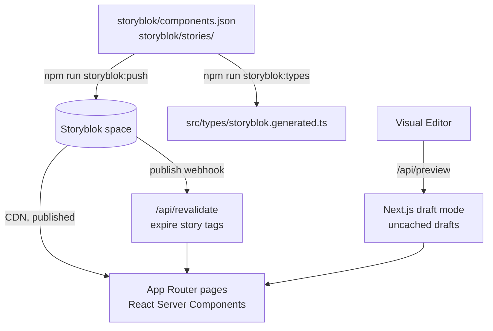

# Architecture

Next Story is a demo B2B marketing site. The **repo and host** advertise the stack (`next-storyblok`); Storyblok owns page content.

## Request path

1. [`src/proxy.ts`](../src/proxy.ts) sets an `x-site-locale` request header from the first path segment. The root layout reads it for `<html lang>`, the German navigation, and JSON-LD.
2. [`src/app/[[...slug]]/page.tsx`](../src/app/[[...slug]]/page.tsx) parses locale and slug (`/`, `/pricing`, `/de`, `/de/pricing`). The `config` story returns 404 as a page.
3. [`src/lib/fetch-story.ts`](../src/lib/fetch-story.ts) loads from the CDN when a token is configured; otherwise the seed stories in `storyblok/stories/` render, translated by [`src/lib/localize.ts`](../src/lib/localize.ts) the same way the CDN resolves `language=de`. Production always requests published content unless draft mode is enabled. Drafts bypass the cache; published fetches share collection and per-story tags across languages, with a 60-second fallback expiry. Missing stories return 404; upstream failures surface as errors, not missing pages.
4. [`src/components/StoryRenderer.tsx`](../src/components/StoryRenderer.tsx) registers blocks on the server. Public stories render through `StoryblokServerComponent`, bypassing the SDK's process-wide editor cache. Authenticated preview uses `StoryblokStory`, which mounts the Visual Editor bridge once. The delivery token stays on the server.
5. [`src/lib/site-config.ts`](../src/lib/site-config.ts) loads the `config` story for the header and footer; the layout falls back to built-in English links when it is missing.
6. [`src/app/api/preview/route.ts`](../src/app/api/preview/route.ts) authenticates, validates the slug and locale, verifies draft content, then enables the cookie. Exit-preview redirects stay on the request origin.
7. [`src/app/api/revalidate/route.ts`](../src/app/api/revalidate/route.ts) accepts publish, unpublish, delete, and move events. Story tags expire immediately in all languages and the sitemap refreshes; move events also expire the old slug; a `config` publish also refreshes the shared layout. Legacy ID-only payloads and moves without an old slug expire the collection and root layout. Invalid JSON or story paths return 400 without cache changes; unrelated actions receive a JSON acknowledgement without invalidation.
8. [`src/app/sitemap.ts`](../src/app/sitemap.ts) lists published page stories from the Storyblok Links API in both languages, cached under the collection tag.

## Env

| Variable | Role |
| --- | --- |
| `STORYBLOK_DELIVERY_API_TOKEN` | Preview/delivery token (draft + published) |
| `STORYBLOK_REGION` | `eu` for this space |
| `STORYBLOK_VERSION` | Local default (`draft` or `published`); production enforces `published` outside draft mode |
| `STORYBLOK_PREVIEW_SECRET` | Gates `/api/preview` |
| `STORYBLOK_REVALIDATE_SECRET` | Gates `/api/revalidate` |
| `STORYBLOK_PERSONAL_ACCESS_TOKEN`, `STORYBLOK_SPACE_ID` | `npm run storyblok:push` only; never read by the app |

## Hosting

Production: Vercel + custom domain `https://nextstory.marcopontili.com`. DNS CNAME via Cloudflare. Not a static FTP deploy.

## Analytics and headers

- [`public/matomo.js`](../public/matomo.js) loads self-hosted, cookieless Matomo (site 5) after hydration; [`MatomoRouteTracker`](../src/components/MatomoRouteTracker.tsx) records client navigations.
- [`src/proxy.ts`](../src/proxy.ts) reports AI-assistant fetches (`ChatGPT-User`, `Claude-User`, and the rest of the marcopontili.com access-log needles) to Matomo with `recMode=1` via `waitUntil`. It never changes the response.
- [`next.config.ts`](../next.config.ts) sets CSP, HSTS, `nosniff`, and Referrer-Policy on every route. `frame-ancestors` allows the Storyblok Visual Editor and `script-src` its bridge script.
